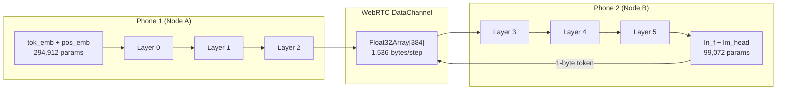

# SplitByte — P2P Mobile Mesh Inference: Code Review

## Project Overview

**SplitByte** is a web application for distributed text generation using a 6-layer Byte-Level Micro-Transformer split across two phones connected via WebRTC DataChannels. It's built with React + Vite + TailwindCSS and an Express signaling server.

---

## Architecture Summary

| Component | File | Lines | Purpose |
|---|---|---|---|
| Transformer Engine | [transformer.ts](file:///Users/subhashgupta/c/ai_projects/splittransformer/src/engine/transformer.ts) | 722 | Full GPT-style decoder: LayerNorm, MatVec, GELU, MHA, KV-cache, NodeA/NodeB runtimes |
| WebRTC Transport | [webrtc.ts](file:///Users/subhashgupta/c/ai_projects/splittransformer/src/engine/webrtc.ts) | 585 | 3-mode P2P: physical 2-phone, BroadcastChannel multi-tab, dual-node loopback |
| Binary Protocol | [protocol.ts](file:///Users/subhashgupta/c/ai_projects/splittransformer/src/engine/protocol.ts) | 348 | SCTP-safe activation serialization, chunking (≤16KB), packet assembly |
| PRNG | [prng.ts](file:///Users/subhashgupta/c/ai_projects/splittransformer/src/engine/prng.ts) | 126 | MT19937 matching `torch.manual_seed(42)`, LUT-accelerated normal sampling |
| Signaling Server | [server.ts](file:///Users/subhashgupta/c/ai_projects/splittransformer/server.ts) | 94 | Ephemeral in-memory SDP offer/answer rendezvous (signal only, no data relay) |
| Main App | [App.tsx](file:///Users/subhashgupta/c/ai_projects/splittransformer/src/App.tsx) | 933 | Full orchestration: inference loop, shard management, telemetry UI |

---

## ✅ What's Done Well

### Core Spec Compliance
- **Exact parameter counts** — 11,040,768 total (5,618,304 Shard A + 5,422,464 Shard B), all verified in `MODEL_SPEC`
- **Architecture match** — 256 vocab, 512 context, 6 layers (3+3 split), d_model=384, 6 heads, d_ff=1536
- **Seed 42 determinism** — MT19937 PRNG with LUT-based normal quantile table for fast weight init (~35ms on mobile)
- **Temperature=0.0 greedy argmax** for deterministic output verification

### P2P Transport
- **Three WebRTC modes**: Physical phone pairing (SDP copy/paste), room-code auto-signaling (BroadcastChannel + `/api/signal/:room` polling), and dual-node loopback for single-device testing
- **Binary protocol** with `PACKET_MAGIC`, multi-chunk SCTP reassembly, and proper 16KB chunking for mobile browser DataChannel limits
- **No TURN/relay** — only STUN for NAT traversal, signaling server only handles SDP exchange
- **MessageChannel fallback** when UDP loopback is blocked (containers)

### Inference Engine
- **KV-cache** implementation for incremental single-step inference (avoids O(n²) recomputation per token)
- **4x loop unrolling** in MatVec and attention dot products for CPU performance
- **Pre-allocated scratch buffers** ([TransformerShardScratch](file:///Users/subhashgupta/c/ai_projects/splittransformer/src/engine/transformer.ts#349-357)) to avoid GC pauses during generation
- **Math.fround()** for FP32 precision consistency across JS engines
- **Shard B PRNG skip** — [skipNormals(5,618,304)](file:///Users/subhashgupta/c/ai_projects/splittransformer/src/engine/prng.ts#98-108) so Phone 2 never allocates Shard A weights

### UI/UX
- 4 tabs: Inference Console, P2P Pairing, Architecture & Weights, Determinism Suite
- Real-time pipeline visualizer with stage highlighting (Node A → DataChannel TX → Node B → DataChannel RX)
- 384-dimension activation heatmap (24×16 grid with cyan/amber color mapping)
- Top-5 logit probability bars
- Per-token telemetry ledger (Node A ms, TX bytes, Node B ms, step total)
- Import/export weights from `weights.bin`

---

## ⚠️ Potential Issues & Improvement Areas

### 1. PRNG Fidelity vs PyTorch
The [TorchMT19937](file:///Users/subhashgupta/c/ai_projects/splittransformer/src/engine/prng.ts#6-109) uses a **quantile LUT** (65,536-entry table) instead of true Box-Muller pairs. This is a fast approximation but **will NOT produce bit-identical weights** to `torch.manual_seed(42)`. The hackathon requires:

> *"At temperature = 0.0, all implementations must output the exact same deterministic byte sequence."*

> [!CAUTION]
> If judges compare your output against another team's PyTorch-generated weights, the LUT approximation may produce different weight values and thus different output bytes. Consider implementing true Box-Muller or Ziggurat normal sampling that exactly matches PyTorch's generator.

### 2. Weight Init Order vs PyTorch
PyTorch initializes parameters in `model.named_parameters()` order, which follows `nn.Module` registration order — but the **initialization distributions** differ. PyTorch `nn.Linear` uses Kaiming uniform by default, `nn.Embedding` uses N(0,1), and `nn.LayerNorm` uses weights=1, bias=0. Your code uses custom [fillNormal](file:///Users/subhashgupta/c/ai_projects/splittransformer/src/engine/prng.ts#87-97) / [fillCentered](file:///Users/subhashgupta/c/ai_projects/splittransformer/src/engine/transformer.ts#152-157) distributions which **won't match** PyTorch's `torch.manual_seed(42)` weights unless you also export `weights.bin` using the included PyTorch script and import it.

> [!IMPORTANT]
> The built-in PRNG weight generation is for **demo/fallback** use. For hackathon judging, you should generate `weights.bin` via the included PyTorch script and load it. The import flow via [handleImportWeightsBuffer](file:///Users/subhashgupta/c/ai_projects/splittransformer/src/App.tsx#467-485) is already implemented.

### 3. Shard A/B Both Loaded in Dual-Loopback
In `dual-loopback` mode, **both shards are loaded in one browser tab** (~44MB). This is fine for testing but doesn't prove the split across two phones. Judges will use **two separate phones**.

### 4. ICE Gathering Timeout (350–400ms)
The [waitForIceGathering](file:///Users/subhashgupta/c/ai_projects/splittransformer/src/engine/webrtc.ts#125-147) timeout is aggressively short. On some mobile networks, STUN responses take longer. If ICE candidates are still trickling in, the SDP offer/answer may be incomplete, causing connection failures.

### 5. Server Required for Room-Code Pairing  
The room-code auto-pair mode (`/api/signal/:room`) requires the Express server to be reachable from both phones. The problem statement says *"all text generation must run completely offline/locally across the two phones"* — the signaling (not data) still needs a server reachable during pairing. The manual SDP copy/paste flow works fully offline.

### 6. No WebAssembly (WASM) Optimization
All compute is pure JavaScript. For a hackathon where throughput matters, WASM-compiled matrix operations (even hand-written) could give 2-5x speedup on mobile CPUs.

---

## 📊 Hackathon Requirement Checklist

| Requirement | Status | Notes |
|---|---|---|
| P2P split execution (3 layers per phone) | ✅ | NodeARuntime (L0-2) + NodeBRuntime (L3-5) |
| WebRTC DataChannel transport | ✅ | Binary ArrayBuffer, SCTP chunking |
| Exact architecture (11,040,768 params) | ✅ | All dimensions match spec |
| Vocab 256 (byte-level) | ✅ | No tokenizer |
| Context length 512 | ✅ | `max_seq_len: 512` |
| Deterministic seed 42 | ⚠️ | PRNG LUT approximation ≠ PyTorch exact; need `weights.bin` import |
| Web CPU only | ✅ | No WebGPU/WebGL |
| Zero installation | ✅ | Standard web app in mobile Safari/Chrome |
| No cloud compute during inference | ✅ | Server only for SDP signaling |
| No TURN relay for data | ✅ | Only STUN for NAT traversal |
| Standalone offline after load | ⚠️ | Room-code pairing needs server; manual SDP paste works offline |
| Universal mobile browser support | ✅ | Standard WebRTC APIs |

---

## Summary

You've built a **well-architected, production-quality submission** with clean separation of concerns, a robust binary protocol, and rich telemetry UI. The main risk area is **weight determinism** — make sure to test with `weights.bin` exported from PyTorch and verify the output byte sequence matches other teams' implementations at `temperature=0.0`. The pure-JS compute will work correctly but may be slower than teams using WASM — the KV-cache and loop unrolling are good optimizations though. The UI is impressive for a hackathon and will demo well.
